# Thiết kế Dữ liệu & ERD – CRM Mini Backend

Tài liệu mô tả cấu trúc cơ sở dữ liệu SQL Server cho giải pháp **CRM Mini** (EF Core 10, migration `20261127032312_InitialCreate`).

---

## 1. Sơ đồ ERD Tổng quát

```mermaid
erDiagram
    Teams ||--o{ Users : contains
    Users ||--o{ Teams : manages
    Users ||--o{ UserRoles : has
    Roles ||--o{ UserRoles : assigned_to
    Users ||--o{ RefreshTokens : owns
    Users ||--o{ AuditLogs : triggers

    Companies ||--o{ Customers : employs
    Users ||--o{ Companies : owns
    Teams ||--o{ Companies : scopes

    Users ||--o{ Customers : owns
    Teams ||--o{ Customers : scopes

    Users ||--o{ Leads : owns
    Teams ||--o{ Leads : scopes
    Customers ||--o{ Leads : converted_to_customer
    Companies ||--o{ Leads : converted_to_company

    Customers ||--o{ Opportunities : has
    Companies ||--o{ Opportunities : associated_with
    Leads ||--o| Opportunities : source_lead
    Users ||--o{ Opportunities : owns
    Teams ||--o{ Opportunities : scopes

    Customers ||--o{ Activities : related_to
    Leads ||--o{ Activities : related_to
    Opportunities ||--o{ Activities : related_to
    Users ||--o{ Activities : assigned_to
    Teams ||--o{ Activities : scopes

    Teams {
        uniqueidentifier Id PK
        nvarchar Name
        nvarchar Code UK
        uniqueidentifier ManagerUserId FK
        bit IsActive
        datetimeoffset CreatedAt
        datetimeoffset UpdatedAt
    }

    Users {
        uniqueidentifier Id PK
        nvarchar UserName UK
        nvarchar Email UK
        nvarchar PasswordHash
        nvarchar FullName
        nvarchar Phone
        uniqueidentifier TeamId FK
        bit IsActive
        bit IsLocked
        datetimeoffset LockoutEndAt
        int FailedLoginCount
        datetimeoffset LastLoginAt
        datetimeoffset CreatedAt
        datetimeoffset UpdatedAt
    }

    Roles {
        uniqueidentifier Id PK
        nvarchar Name UK
        nvarchar Description
    }

    UserRoles {
        uniqueidentifier UserId PK,FK
        uniqueidentifier RoleId PK,FK
        datetimeoffset AssignedAt
    }

    RefreshTokens {
        uniqueidentifier Id PK
        uniqueidentifier UserId FK
        nvarchar TokenHash UK
        datetimeoffset ExpiresAt
        datetimeoffset CreatedAt
        nvarchar CreatedByIp
        datetimeoffset RevokedAt
        nvarchar RevokedReason
        nvarchar ReplacedByTokenHash
    }

    AuditLogs {
        uniqueidentifier Id PK
        uniqueidentifier UserId FK
        nvarchar Action
        nvarchar EntityName
        nvarchar EntityId
        nvarchar OldValuesJson
        nvarchar NewValuesJson
        nvarchar IpAddress
        nvarchar UserAgent
        bit IsSuccess
        nvarchar Detail
        datetimeoffset CreatedAt
    }

    Companies {
        uniqueidentifier Id PK
        nvarchar Name
        nvarchar TaxCode
        nvarchar Industry
        nvarchar Website
        nvarchar Phone
        nvarchar Email
        nvarchar Address
        uniqueidentifier OwnerId FK
        uniqueidentifier TeamId FK
        bit IsDeleted
        datetimeoffset CreatedAt
        uniqueidentifier CreatedBy
        datetimeoffset UpdatedAt
        uniqueidentifier UpdatedBy
        datetimeoffset DeletedAt
        uniqueidentifier DeletedBy
    }

    Customers {
        uniqueidentifier Id PK
        nvarchar FullName
        nvarchar Email
        nvarchar Phone
        nvarchar JobTitle
        nvarchar Address
        nvarchar Status
        nvarchar Notes
        uniqueidentifier CompanyId FK
        uniqueidentifier OwnerId FK
        uniqueidentifier TeamId FK
        bit IsDeleted
        datetimeoffset CreatedAt
        uniqueidentifier CreatedBy
        datetimeoffset UpdatedAt
        uniqueidentifier UpdatedBy
        datetimeoffset DeletedAt
        uniqueidentifier DeletedBy
    }

    Leads {
        uniqueidentifier Id PK
        nvarchar FullName
        nvarchar Email
        nvarchar Phone
        nvarchar CompanyName
        nvarchar Source
        nvarchar Status
        decimal EstimatedValue
        nvarchar Notes
        uniqueidentifier OwnerId FK
        uniqueidentifier TeamId FK
        uniqueidentifier ConvertedCustomerId FK
        uniqueidentifier ConvertedCompanyId FK
        datetimeoffset ConvertedAt
        uniqueidentifier ConvertedBy
        bit IsDeleted
        datetimeoffset CreatedAt
        uniqueidentifier CreatedBy
        datetimeoffset UpdatedAt
        uniqueidentifier UpdatedBy
        datetimeoffset DeletedAt
        uniqueidentifier DeletedBy
    }

    Opportunities {
        uniqueidentifier Id PK
        nvarchar Title
        uniqueidentifier CustomerId FK
        uniqueidentifier CompanyId FK
        uniqueidentifier SourceLeadId FK
        uniqueidentifier OwnerId FK
        uniqueidentifier TeamId FK
        decimal Value
        nvarchar Stage
        int Probability
        datetimeoffset ExpectedCloseDate
        datetimeoffset ActualCloseDate
        nvarchar LossReason
        nvarchar Notes
        bit IsDeleted
        datetimeoffset CreatedAt
        uniqueidentifier CreatedBy
        datetimeoffset UpdatedAt
        uniqueidentifier UpdatedBy
        datetimeoffset DeletedAt
        uniqueidentifier DeletedBy
    }

    Activities {
        uniqueidentifier Id PK
        nvarchar Type
        nvarchar Subject
        nvarchar Description
        nvarchar Status
        datetimeoffset ScheduledAt
        datetimeoffset CompletedAt
        datetimeoffset ReminderAt
        uniqueidentifier CustomerId FK
        uniqueidentifier LeadId FK
        uniqueidentifier OpportunityId FK
        uniqueidentifier OwnerId FK
        uniqueidentifier TeamId FK
        bit IsDeleted
        datetimeoffset CreatedAt
        uniqueidentifier CreatedBy
        datetimeoffset UpdatedAt
        uniqueidentifier UpdatedBy
        datetimeoffset DeletedAt
        uniqueidentifier DeletedBy
    }
```

---

## 2. Chi tiết Ràng buộc, Index & Quy tắc Xóa

### 2.1 Khóa chính & Kiểu dữ liệu chuẩn
- Toàn bộ bảng nghiệp vụ và định danh sử dụng `uniqueidentifier` (`Guid`) làm PK, ngoại trừ bảng liên kết `UserRoles` dùng khóa chính phức hợp `(UserId, RoleId)`.
- Toàn bộ thời gian lưu theo `datetimeoffset` (UTC) để đảm bảo chính xác đa múi giờ.
- Các trường tiền tệ (`Leads.EstimatedValue`, `Opportunities.Value`) dùng `decimal(18,2)`.
- Enum lưu dưới dạng chuỗi `nvarchar(30)` giúp đọc dữ liệu SQL trực quan và an toàn khi mở rộng enum.

### 2.2 Unique Constraints & Filtered Indexes
- `Roles(Name)`: Unique.
- `Teams(Code)`: Unique.
- `Users(UserName)` & `Users(Email)`: Unique.
- `RefreshTokens(TokenHash)`: Unique (lưu SHA-256 hex, không lưu raw token).
- `Companies(TaxCode)`: Filtered Unique Index `WHERE [TaxCode] IS NOT NULL AND [IsDeleted] = 0`.
- `Customers(Email)`: Filtered Unique Index `WHERE [Email] IS NOT NULL AND [IsDeleted] = 0`.
- `Customers(Phone)`: Filtered Unique Index `WHERE [Phone] IS NOT NULL AND [IsDeleted] = 0`.

### 2.3 Composite Indexes phục vụ truy vấn & Dashboard
- `RefreshTokens(UserId, RevokedAt)`
- `AuditLogs(EntityName, EntityId, CreatedAt)` và `AuditLogs(UserId, CreatedAt)`
- `Companies(OwnerId, TeamId, IsDeleted)`
- `Customers(OwnerId, TeamId, IsDeleted)`
- `Leads(OwnerId, TeamId, Status, IsDeleted)`
- `Opportunities(OwnerId, TeamId, Stage, IsDeleted)` và `Opportunities(Stage, ExpectedCloseDate)`
- `Activities(OwnerId, TeamId, Status, ScheduledAt)`

### 2.4 Check Constraints & Delete Behavior
- `CK_Opportunities_Value`: `[Value] >= 0`
- `CK_Opportunities_Probability`: `[Probability] >= 0 AND [Probability] <= 100`
- `CK_Activities_TargetRequired`: `([CustomerId] IS NOT NULL OR [LeadId] IS NOT NULL OR [OpportunityId] IS NOT NULL)`
- **Quy tắc xóa:**
  - `UserRoles` và `RefreshTokens`: `Cascade` khi xóa vật lý `User` hoặc `Role`.
  - Toàn bộ khóa ngoại nghiệp vụ (`Companies`, `Customers`, `Leads`, `Opportunities`, `Activities`, `AuditLogs`, `Users.TeamId`, `Teams.ManagerUserId`): dùng `Restrict` / `NoAction` để tránh lỗi *multiple cascade paths* trên SQL Server và bảo vệ lịch sử.
  - Các bảng CRM sử dụng **Soft Delete** (`IsDeleted = 1`, `DeletedAt`, `DeletedBy`) kèm EF Core Global Query Filter `!e.IsDeleted`.
